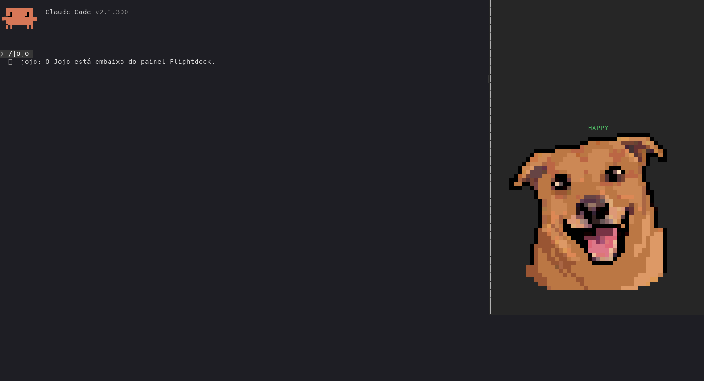

# jojo

Um cachorro em pixel art no painel do Claude Code que mostra, de relance, o que o Claude está fazendo:

| Humor | Quando |
|---|---|
| **HAPPY** | o Claude terminou uma resposta (por 6 s) |
| **BARKING** | o Claude precisa de você: pedido de permissão, pergunta (`AskUserQuestion`) ou plano (`ExitPlanMode`) |
| **WAITING** | o Claude está trabalhando ou acabou de ficar inativo |
| **SLEEPING** | 30 s sem turno ativo, aviso de inatividade ou turno encerrado por erro de API (incluindo créditos esgotados) |

## Autor

Daniel Souza ([@daneiel](https://github.com/daneiel)).

## Instalar

No prompt do Claude Code (terminal):

```text
/plugin install jojo --marketplace viralabs-dev/claude-mods
```

O mesmo mod sai direto deste repositório, sem o catálogo: `/plugin install jojo --marketplace viralabs-dev/jojo`.

Responda `y` para adicionar o marketplace e escolha o escopo de usuário. Vale a partir da próxima sessão (ou depois de `/reload-plugins`).

## Para que serve

Saber, sem ler a conversa, se o Claude terminou, se espera por você ou se ainda trabalha. O desenho usa até 48×26 células de meio-bloco (`▀`) coloridas, lidas dos quatro GIFs completos em `assets/` (4 humores × 8 quadros, com o tempo de cada quadro), e precisa de um terminal com cor de 24 bits. Fora do terminal (desktop, VS Code, celular) o painel mostra só o rótulo do humor.

O painel lateral abre sozinho em janelas largas (de 110 a 144 colunas, conforme o motor); abaixo disso, `/jojo` abre. Com o plugin [Flightdeck](https://github.com/scasella/claude-flightdeck) instalado, o Jojo é desenhado no fundo do painel dela, e o painel próprio fecha.

## Exemplos (telas reais)

Capturas do Claude Code 2.1.300.

### Embaixo da Flightdeck



## Comandos

| Comando | O que faz |
|---|---|
| `/jojo` | abre o painel do Jojo (ou avisa que ele está embaixo da Flightdeck) |
| `/jojo happy`, `/jojo barking`, `/jojo waiting`, `/jojo sleeping` | testa cada animação no painel real, sem chamar o modelo; Esc devolve o foco ao prompt |

## Capacidades usadas

Saída de `claude plugin validate .`:

- Eventos: `session.start`, `command.run` (`/jojo`), `turn.start`, `turn.complete`, `tool.call`, `classic.PermissionRequest`, `classic.Notification`, `ui.render` dos painéis `jojo` e `flightdeck`.
- `tool.call`, `classic.PermissionRequest` e `classic.Notification` só **observam**: todo hook repassa o evento intacto com `next(e)` e nunca muda nem barra uma ferramenta; uma falha do mod ao gravar o humor é engolida.
- `$.state` (`jojo.mood`): o humor mostrado.
- `$.clock.every`, `$.ui.blit`: a animação, que troca só as células do desenho a cada quadro.
- `$.command.register`, `$.ui.open`, `$.ui.close`, `$.ui.resolve`: o comando e o painel.

Nenhuma capacidade sensível: não usa processo, rede, arquivos, modelos nem MCP, e não lê prompt nem o conteúdo das chamadas de ferramenta.

## Configuração

Nenhuma por pessoa. No código: `IDLE_MS`, `HAPPY_MS` e `FRAME_MS` em `hooks/mood.ts` (quanto dura o HAPPY e os intervalos padrão). O tempo de cada quadro vem do GIF do humor, gravado em `hooks/frames.ts` (`DURATIONS`).

## Dependências de sistema

Nenhuma para usar. Para regenerar: Python 3 com Pillow. `python3 tools/build_gifs.py` faz os GIFs a partir das faixas PNG; `python3 tools/build_frames.py` lê os GIFs e escreve `hooks/frames.ts`.

## Sprites por animação

- `assets/happy.png`: oito quadros de HAPPY, com sorriso, língua, orelhas e brilho.
- `assets/barking.png`: oito quadros de BARKING.
- `assets/sleeping.png`: oito quadros de cochilo, cabeça tombando, despertar breve e retorno ao sono. Ciclo de 3,74 s; ZzZ animado próximo ao topo da cabeça, oculto nos dois quadros do despertar, sem diminuir o personagem.
- `assets/waiting.png`: oito quadros de WAITING, com boca fechada, respiração suave e piscada gradual.

Cada PNG tem 2048×256 pixels, com oito células quadradas de 256×256, da esquerda para a direita. Mantenha a escala, o alinhamento e o fundo transparente ao editar. O `tools/build_gifs.py` detecta a quantidade de quadros pela largura da faixa, permitindo expandir cada animação independentemente.

`python3 tools/slice_frames.py saida.json` exporta em JSON os pixels lidos dos GIFs; `python3 tools/build_frames.py` atualiza os quadros e os tempos usados pelo painel. Ambos aceitam `--assets-dir` e `--size` (par, padrão 48). O recortador JSON usa nearest-neighbor. O gerador Raster usa média de área, cobertura do contorno e preservação de linhas escuras para não perder olhos, boca e bordas na redução; as poses nunca são misturadas. Alfa abaixo de 128 na fonte vira transparência.

HAPPY tem um ciclo de 960 ms, com sorriso sustentado, movimento de língua e orelhas, piscada curta e um brilho dourado em algumas poses. BARKING tem um ciclo de 1,14 s: boca fechada por 360 ms, abertura rápida, 290 ms nas poses de maior abertura e recuperação. Os sinais dourados acompanham os quadros de latido. WAITING tem um ciclo de 2,4 s: repouso com olhos abertos, transições de 80–120 ms e 160 ms para as duas poses de olhos fechados. O relógio consulta o tempo real e preserva a sobra entre quadros, evitando acumular atraso. O JPEG original continua disponível como referência, mas não participa mais da geração.

O gerador também escreve `hooks/frames-8.ts`, `frames-16.ts`, `frames-24.ts`, `frames-32.ts` e `frames-40.ts`. São módulos separados para respeitar o limite de 1 MiB por arquivo do carregador do Claude Code. `hooks/layout.ts` escolhe o maior tamanho que cabe em `bodyColumns`, com uma coluna de margem em cada lado. O Raster e cada `ui.blit` usam a mesma largura e altura, tanto no painel próprio quanto no Flightdeck; painéis menores que 10 colunas mostram só o rótulo.

## GIFs completos

`assets/happy.gif`, `assets/barking.gif`, `assets/waiting.gif` e `assets/sleeping.gif` são animações autônomas, transparentes e com repetição contínua. Cada GIF tem oito quadros e 256×280 pixels: os 256×256 pixels do personagem são preservados, com 24 pixels acima para o ZzZ. O ZzZ já está incorporado ao GIF de cochilo e desaparece durante o despertar.

Abra `assets/animation-jojo.html` no navegador para comparar os quatro estados em fundo escuro, claro ou xadrez. A galeria incorpora os GIFs e os downloads como dados no próprio HTML, funcionando também em visualizadores que não resolvem arquivos vizinhos. Em interfaces com suporte a GIF, basta usar o arquivo inteiro, por exemplo ``, sem recortar quadros.

Para atualizar os arquivos: `python3 tools/build_gifs.py` (Pillow). As durações ficam em `TIMINGS`, no próprio gerador, e os sinais de sono em `tools/sleep_art.py`. O gerador usa uma paleta estável por animação, com a cor exata do ZzZ reservada (o pelo nunca a usa), e valida todos os quadros depois de decodificar o GIF. Aceita `--assets-dir` e `--output-dir`.

GIF armazena tempo em passos de 10 ms. O exportador arredonda os limites acumulados para evitar deriva: HAPPY 960 ms, BARKING 1140 ms, WAITING 2400 ms e SLEEPING 3740 ms. `assets/animations.json` registra as durações originais e exportadas, dimensões e arquivos.

**Os GIFs são a fonte do painel.** O motor do Claude Code não desenha GIF (o elemento `Image` só aceita PNG ou pixels crus, e só em terminais com o protocolo gráfico do kitty), então o painel continua num `Raster` de meio-blocos. Mas os quadros e os tempos saem dos GIFs: trocar um GIF e rodar `python3 tools/build_frames.py` muda a animação, sem recortar quadros à mão. O ZzZ do GIF é descartado na leitura e redesenhado na escala do terminal, para continuar legível. As PNGs continuam como fontes editáveis dos GIFs.

## Limites conhecidos

- Onde uma organização gerencia o Claude Code, `classic.PermissionRequest` e `classic.Notification` não rodam em plugins instalados pela pessoa: lá o Jojo só late nas perguntas e nos planos.
- O Jojo precisa vir **antes** da Flightdeck em `enabledPlugins` no `~/.claude/settings.json`: a Flightdeck desenha o próprio painel sem passar a vez, e o plugin que vem antes fica por fora. Na ordem inversa, o Jojo abre numa aba própria ao lado dela. Reinstalar a Flightdeck (`claude plugin uninstall` e `install`) a leva para o fim da lista.

## Licença

[MIT](LICENSE), para o código e os sprites em `assets/`. A folha original foi gerada por IA (Gemini); as faixas PNG foram derivadas da versão ampliada com a ferramenta de imagem do Codex. As imagens são publicadas sem garantia de direitos de terceiros.

## Como remover

```text
claude plugin uninstall jojo@viralabs-mods     # instalado pelo catálogo
claude plugin uninstall jojo@viralabs-jojo     # instalado direto deste repositório
```

## Versão do Claude Code validada

2.1.300, no Linux.

## Detalhes do desenho

O cochilo não interrompe o Claude nem consulta saldo. Usa o término de turno com `reason: error`; outros erros de API também acionam SLEEPING. Um novo turno acorda o Jojo, e perguntas/permissões têm prioridade. Turnos longos não contam como inatividade.

As linhas transparentes imediatamente acima da cabeça no Raster contêm o mesmo bitmap de letras do GIF (z → zZ → ZzZ), desenhado em meio-blocos, sem depender da fonte. Em painéis com menos de 24 colunas de imagem, uma letra animada preserva a legibilidade. O gerador preserva integralmente os pixels do cachorro e mantém a mesma altura nos outros estados para não deslocar o painel.

BARKING, WAITING e SLEEPING usam HAPPY como referência de paleta e acabamento: marrons/caramelo, sombras no focinho e interior das orelhas, e pelo com blocos de cor e dobras no pescoço. As durações (`TIMINGS` em `tools/build_gifs.py`, gravadas em cada GIF) e o ZzZ animado do terminal ficam fora das PNGs.

BARKING, WAITING e SLEEPING também têm contorno preto em pixel art ao redor da cabeça, orelhas e pescoço, usando HAPPY como referência. O contorno faz parte dos PNGs-fonte e aparece tanto nos GIFs quanto no Raster.

Nos GIFs, o ZzZ usa letras 50% maiores e acompanha o topo da cabeça com espaço de 8–14 pixels, desaparecendo nos dois quadros do despertar. Os outros estados seguem o estilo cartunizado de HAPPY: contorno preto em degraus, blocos de cor, sombras simplificadas e olhos caramelo.

O corpo de 50 colunas observado no Claude Code comporta agora o Raster de 48×26 células (48×48 pixels do cão e quatro linhas de pixels de folga). A largura deixa uma coluna livre de cada lado. Use terminal True Color; o host ainda quantiza RGB em passos de 17. `python3 tools/test_frames.py` verifica os contornos e que o ZzZ não cobre o personagem nem permanece durante o despertar.
