# ViraPets

**[Abra o criador online de mascotes](https://daneiel.github.io/virapets/)** — crie um animal procedural, transforme uma foto local em pixel art ou copie o prompt para criar uma ilustração em outra plataforma. Veja os quatro humores e exporte seu pacote. O editor local não exige conta nem chave de API.

## Primeiros passos

O [ViraPets Studio](https://daneiel.github.io/virapets/) oferece três formas de criação:

| Modo | O que você faz | Resultado |
|---|---|---|
| Desenho procedural | Escolhe espécie, raça ou tipo, cores, nome, ID do pacote e autoria | Um personagem original em pixel art, sem baixar modelos |
| Foto local → pixel art | Escolhe uma foto, refina o recorte, pixeliza e retoca | Seu recorte com movimentos animados; segmentação local com SlimSAM é opcional |
| Prompt completo | Copia o prompt e anexa sua foto em uma plataforma com geração de imagens | Um pet ilustrado gerado separadamente; os arquivos entregues dependem das ferramentas da plataforma |

Para experimentar, abra o desenho procedural, personalize o personagem e alterne entre os quatro humores. No modo foto, teste primeiro o exemplo sintético antes de escolher uma foto pessoal. O recorte assistido é opcional: a primeira ativação baixa **36.315.496 bytes descompactados** de ferramentas e pesos do modelo. Os pincéis manuais funcionam sem esse download. O processamento da foto acontece no navegador. A receita JSON salva a pixel art derivada, sem a foto original ou seus metadados EXIF. Salve uma receita antes de fechar a página para continuar depois.

Baixe o ZIP com as quatro faixas de sprites e o manifesto, o PNG do humor selecionado, o JSON para retomar a edição ou o arquivo `.wastickers` para um aplicativo importador Android compatível. O site não instala figurinhas diretamente no WhatsApp. Para usar seu pet no Claude Code, siga as etapas de clonagem, Python/Pillow, `deliver`, `validate` e, opcionalmente, `build` no [passo a passo de instalação](#crie-seu-próprio-pet-com-sua-imagem). O [guia detalhado do editor](site/README.md), em inglês, explica edição, privacidade, exportações e solução de problemas; as instruções abaixo estão em português brasileiro.


No desenho procedural, escolha **cachorro, gato, pato, galinha, pintinho, coelho, vaca, boi, lhama, camelo, passarinho ou lagarto**. Cachorros, gatos, coelhos e vacas oferecem raças/variedades; aves e répteis oferecem tipos, como calopsita, papagaio, iguana e camaleão. As opções modificam silhuetas e detalhes de desenhos estilizados. As cores continuam personalizáveis. Receitas antigas sem espécie abrem como cachorro SRD. Para animais que não são cães, o segundo humor aparece como **Chamando**, mantendo a chave técnica `barking` para compatibilidade dos pacotes.


Pets em pixel art que acompanham o Claude Code. Jojo, Mel e Dara compartilham o mesmo painel, eventos e relógio; cada personagem tem suas próprias imagens e tempos.

| Pet | Identidade | Estado da arte |
|---|---|---|
| Jojo | cão caramelo, contorno preto e olhos caramelo | arte aprovada, preservada da versão 0.2.0 |
| Mel | Shih Tzu creme, orelhas caídas e um dentinho inferior esquerdo | visual aprovado pelo criador do projeto |
| Dara | cadela clara e castanha, óculos, bandana vermelha e orelhas assimétricas | redução otimizada para painel estreito e monitor vertical |

Abra `assets/animation-virapets.html` para ver os 12 GIFs, com fundo claro/escuro, ZIP dos GIFs e pacotes de figurinhas incorporados. A galeria funciona sem servidor.

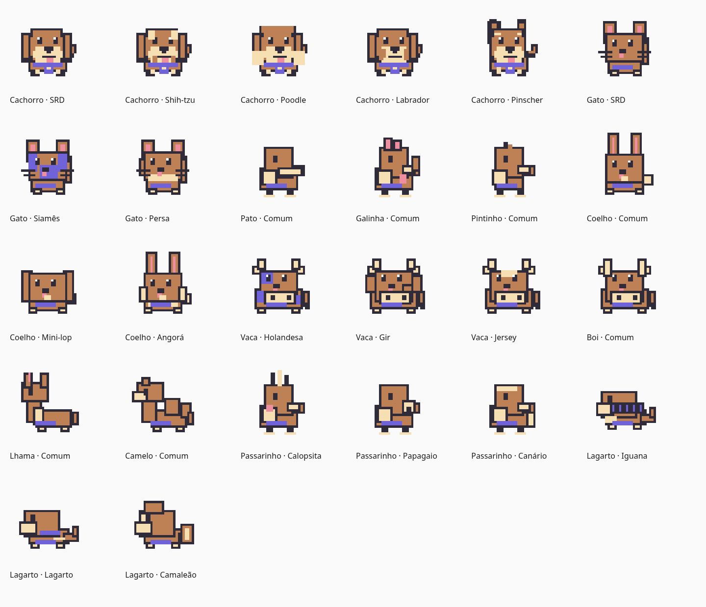

## Pets animados

Os quatro estados de cada pet, nos GIFs aprovados da galeria:

| Estado | Jojo | Mel | Dara |
|---|---|---|---|
| HAPPY | 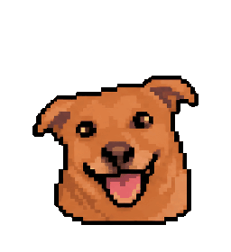 | 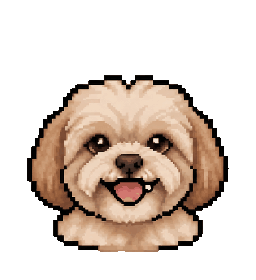 | 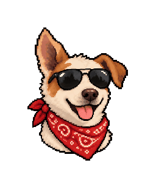 |
| BARKING | 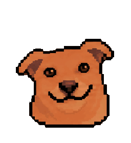 | 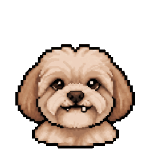 | 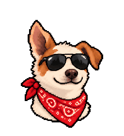 |
| WAITING | 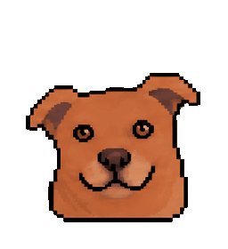 | 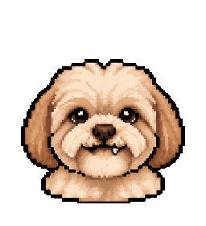 | 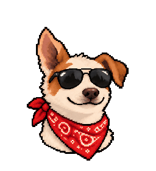 |
| SLEEPING | 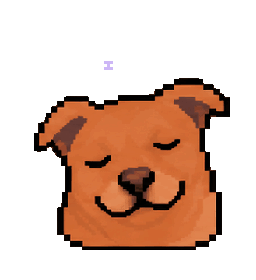 | 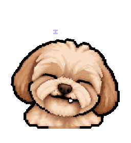 | 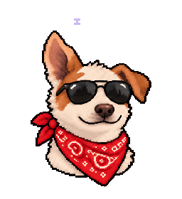 |

## No Claude em ação

Gravações da instalação local **ViraPets 0.4.0**, no **Claude Code 2.1.301**, com **Flightdeck 0.4.0**. Os GIFs abaixo foram renderizados a partir da saída real do terminal (PTY de 150×48 células); a resolução do painel é menor que a dos GIFs da galeria.

**Jojo — HAPPY** · `/virapets jojo happy`

As capturas abaixo tiveram dados de conta, caminhos locais e métricas da sessão ocultados em todos os quadros.

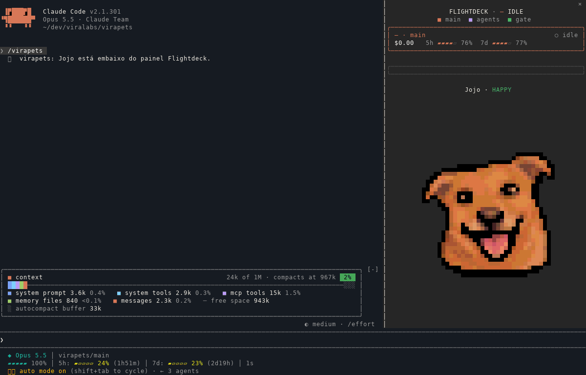

[Ver captura estática](docs/capturas/jojo-no-claude-0.4.0.png)

**Mel — BARKING** · `/virapets mel barking`

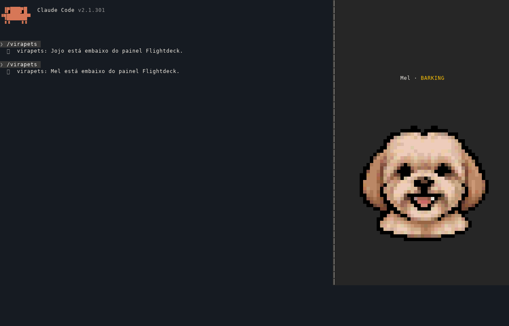

[Ver captura estática](docs/capturas/mel-no-claude-0.4.0.png)

**Dara — SLEEPING** · `/virapets dara sleeping`

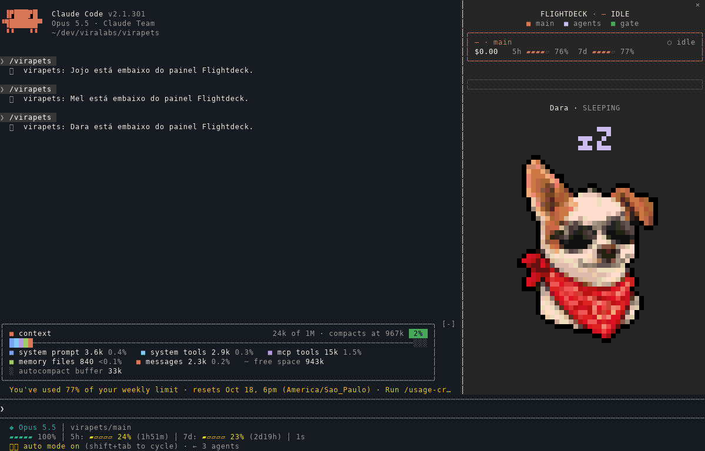

[Ver captura estática](docs/capturas/dara-no-claude-0.4.0.png)

[Origem dos arquivos e detalhes da gravação](docs/capturas/README.md).

## Comandos

```text
/virapets jojo
/virapets mel happy
/virapets dara barking
/virapets mel waiting
/virapets dara sleeping
/virapets list
```

`/virapets` abre o pet atual; sem humor, a seleção conserva o humor atual. `/jojo [happy|barking|waiting|sleeping]` continua como atalho para Jojo. Nomes ou humores inválidos mostram a ajuda sem mudar a seleção. Os comandos não chamam o modelo. Esc devolve o foco ao prompt.

| Humor | Quando |
|---|---|
| HAPPY | resposta principal concluída; volta a WAITING em 6 s |
| BARKING | permissão, pergunta AskUserQuestion ou plano ExitPlanMode |
| WAITING | turno ativo ou início de repouso |
| SLEEPING | 30 s de repouso, idle_prompt ou turno encerrado por erro de API |

Os eventos automáticos continuam após a escolha manual. Um turno novo acorda o pet; um turno longo não conta como inatividade. Erro de API pode incluir falta de créditos, mas o plugin não consulta saldo. Respostas de subagentes não mudam o humor.

## Instalação e migração

A versão 0.4.0 inclui o fluxo de criação de pets, galeria com o pet do usuário em destaque e downloads dos GIFs e figurinhas. Instale pelo catálogo:

```text
/plugin install virapets --marketplace viralabs-dev/claude-mods
```

Também é possível instalar diretamente:

```text
/plugin install virapets --marketplace viralabs-dev/virapets
```

Antes de ativar ViraPets, desative o plugin antigo `jojo@viralabs-mods` (ou `jojo@viralabs-jojo`) para não carregar dois painéis e dois comandos `/jojo`. A escolha começa em Jojo/WAITING; a chave antiga `jojo.mood` não é migrada. Depois, use `/reload-plugins` ou abra outra sessão. O estado `virapets.selection` preserva pet e humor nas recargas do módulo.

Para instalar o clone local sem publicar: `claude plugin install virapets --marketplace /caminho/do/clone/virapets --scope user`. Essa instalação usa `virapets@viralabs-virapets`; desative o antigo `jojo@viralabs-mods` e mantenha ViraPets antes da Flightdeck em `enabledPlugins`.

Para desenvolvimento local, carregue a pasta com `claude --plugin-dir .`. Para um teste isolado da configuração instalada: `claude --plugin-dir . --setting-sources '' --strict-mcp-config`.

Remoção: `claude plugin uninstall virapets@viralabs-mods` (catálogo) ou `virapets@viralabs-virapets` (direto).

## Organização

```text
assets/pets/<id>/
  pet.json                 identificação, tempos e ZzZ por quadro
  sprites/<humor>.png       faixas editáveis, células quadradas
  animations/<humor>.gif    fonte dos quadros e tempos do painel
  animations/animations.json
  references/              referência e prompts da arte
assets/animation-virapets.html
generated/catalog.ts       catálogo compilado; não editar
generated/pets/<id>/frames*.ts
hooks/                     eventos, seleção, relógio e layout
tools/pets.py             entrada única da ferramenta
tools/virapets/            módulos compartilhados
tools/tests/              testes do pipeline Python
tests/                     testes no motor Claude Code
```

`hooks/pets.ts` resolve a seleção e valida comandos. `hooks/mood.ts` mantém as regras dos humores. `hooks/animation.ts` avança conforme os tempos do pet; `hooks/layout.ts` escolhe o tamanho que cabe. `hooks/register.tsx` conecta tudo ao Claude e à Flightdeck. Adicionar arte não exige copiar esses módulos.

## Crie no navegador: três caminhos

Abra o [ViraPets Studio](https://daneiel.github.io/virapets/). Para desenvolvimento local, na raiz do clone execute `python3 -m http.server 8000 --directory site` e abra `http://localhost:8000`. Python é apenas o servidor nesse caso; o visitante da página publicada não precisa instalá-lo. Use HTTP para o Worker de recorte assistido; abrir `site/index.html` diretamente pode servir ao desenho procedural, mas não é o caminho recomendado para foto/modelo.

### 1. Desenho procedural, sem modelo

Escolha **Desenho procedural**, altere nome, ID, autor, cores de pelagem/focinho/lenço e orelhas. Um ID como `luna` vira o nome da pasta do pet: use minúsculas, números e hífens, começando por letra, e não sobrescreva um pet existente. Troque entre Feliz, Latindo, Esperando e Dormindo; pause quando quiser examinar um quadro. A arte é geométrica e simples, não uma reprodução de Jojo, Mel ou Dara. Não há geração livre por texto nessa opção.

### 2. Foto → pixel art local

1. O criador fica **aberto na página**, com seletor visível e somente o painel do modo ativo. No modo foto, o bloco procedural inteiro fica oculto; a prévia e a exportação aparecem dentro do editor somente depois de pixelizar. A importação de receita permanece acessível acima dos modos. Alterne sem perder a foto, a máscara, a cabeça marcada ou as configurações. Escolha esse modo e carregue PNG, JPEG ou WebP de até 10 MB/40 megapixels, ou use **Testar com desenho de exemplo**, que cria uma imagem sintética sem foto privada.
2. Recorte o pet. Sem modelo, use **Pincel: manter/apagar**, tamanho do pincel, **Manter tudo**, **Limpar máscara** e **Desfazer máscara**. A área verde é preservada. Com o recorte assistido ativado, marque pontos no pet para incluir e no fundo para excluir; acrescente pontos na cabeça e no corpo se apenas uma parte for selecionada. As setas e Enter também controlam seleção e retoque.
3. Confira a prévia contínua do recorte e ajuste grade de 16–96 e paleta de 2–32 cores, com contorno opcional. Clique **Aplicar recorte e pixelizar** para criar a arte final. Escolha uma cor extraída ou uma cor de retoque e pinte; a borracha remove pixels. Aplicar o recorte novamente substitui os retoques.
4. Marque o centro da cabeça na pixel art final e ajuste seu tamanho (8–100) e lado do focinho (automático/esquerda/direita). A marca é obrigatória antes de exportar e pode ser ajustada depois; reaplicar o recorte a reinicia. A animação usa essa referência para posicionar traços de latido e Zzz acompanhando o movimento. No sono, os quadros 4 e 5 do despertar ficam sem Zzz. A simulação permite conferir a arte existente ou experimentar o desenho sintético sem baixar o modelo.
5. Confira os quatro humores e exporte. Os movimentos transformam o recorte; não criam olhos, bocas nem novas expressões. Para uma nova ilustração a partir da foto, siga o prompt no próximo caminho.

**Recorte assistido é opcional.** SlimSAM q8 executa no navegador via Worker/WASM. A primeira ativação transfere até **36.315.496 bytes não comprimidos** de pesos e runtime (aproximadamente 36,3 MB), além dos arquivos pequenos da página; compressão e cache podem reduzir a transferência real. Os pesos vêm do Hugging Face/CDNs. Isso consome rede, memória e bateria; não exige token nem API paga por imagem. Cache não é garantia de funcionamento offline. Se falhar, use os pincéis ou tente ativar novamente. **Cancelar / liberar modelo** libera a sessão; **Limpar cache do modelo** remove o cache específico dos pesos.

A foto e a máscara ficam na memória da página, sem upload. O download do modelo expõe ao host os metadados normais de rede, como IP; não envia a foto. Receita e ZIP guardam a pixel art derivada e a marcação da cabeça, sem a imagem original, nome do arquivo ou EXIF. Importar a receita permite retocar e reanimar; para refazer o recorte, escolha a foto novamente. Salve antes de recarregar ou descartar a arte.


**Seleção de objeto e fundo:** use “Preferir objeto inteiro” ou “Detalhe / parte”. Mantenha vários pontos no mesmo pet; para acrescentar outra área ou objeto, escolha “Adicionar área”. “Fundo” mostra o inverso da seleção do pet; os pincéis passam a editar essa área. Expanda, contraia ou suavize a máscara e use desfazer/refazer. Escolha fundo transparente ou uma cor antes de aplicar. A foto original fica intacta. Não há garantia de recorte perfeito de pelos; refinamento manual continua disponível.

**Fluidez:** a prévia interpola os movimentos; figurinhas de recorte usam 32 quadros por humor. As faixas PNG conservam oito quadros por humor para o contrato ViraPets. A marcação da cabeça é feita depois de recortar/pixelizar: acompanha a transformação sem depender das coordenadas da foto original. Refazer o recorte pede uma nova marcação. Zzz desaparecem ao despertar; traços de som acompanham o latido. São efeitos visuais sem som, sem redesenhar a boca ou os olhos.

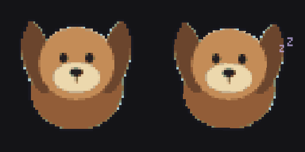

[Captura real do editor](docs/images/photo-animation-desktop.png). A simulação usa o mesmo renderizador da prévia/exportação, com exemplo sintético sem foto privada.

### 3. Prompt completo para uma plataforma de imagem

Clique **Ver e copiar prompt**, copie o texto completo e envie com a foto na plataforma de sua escolha. Se a área de transferência falhar, selecione e copie o texto manualmente ou baixe `prompt.txt`. O site não envia o prompt nem a foto para essa plataforma. Ela precisa ter ferramentas de imagem e arquivos para produzir PNGs reais; os recursos disponíveis determinam se entregará apenas as faixas ou também GIFs, galeria e figurinhas. Não há Gradio, serviço de geração externo ou API gratuita de LLM integrado ao editor. O procedimento local abaixo completa a entrega quando necessário.

### Baixe o resultado e continue depois

| Botão | O que recebe | Próximo passo |
|---|---|---|
| Baixar meu companheiro · ZIP | `assets/pets/<id>/pet.json`, quatro faixas PNG, receita e README de instalação | Extraia a pasta do pet no clone e execute `deliver`/`validate` abaixo |
| PNG deste humor | Uma faixa transparente 2048×256, com oito células de 256×256 | Arquivo de sprites; não é GIF animado |
| Salvar receita JSON | Configuração procedural ou pixel art derivada com marcação da cabeça | Use **Importar JSON** para continuar no editor |
| Baixar figurinhas animadas | Um `.wastickers` com quatro WebPs 512×512 | Abra em importador Android compatível e adicione ao WhatsApp por ele |

Os quatro PNGs do modo foto já incluem seus efeitos de latido/sono, e `sleepSigns` vem com itens `null` para evitar Zzz duplicado pelo pipeline. O modo procedural mantém seus sinais compostos pelo pipeline. Confira o README do pacote antes de editar o manifesto.

A exportação de figurinhas exige suporte Canvas WebP no navegador; se falhar, PNG, ZIP e receita continuam disponíveis. Para gerar e validar GIFs/figurinhas localmente, use o pipeline Python abaixo. A importação Android depende do aplicativo e ainda não foi testada em aparelho físico. Testes em viewport estreita no desktop não comprovam compatibilidade em telefone. O editor oferece tema claro/escuro baseado nos tokens BRABO e favicon do Jojo; esses elementos não alteram os arquivos do pet.

[Guia do editor e solução de problemas](site/README.md) · [Análise do modo procedural](docs/design/characters-without-llm.md) · [Arquitetura da foto local](docs/design/photo-editor-implementation.md).

## Crie seu próprio pet com sua imagem

**Copie o [prompt universal completo](skills/virapets-create-pet/references/prompt.md) e envie junto com a foto** no Claude, Codex, Gemini, Qwen, Grok ou outra LLM. O prompt pede um ZIP com os quatro PNGs, `pet.json` e `README-INSTALAR.md` indicando exatamente onde colocar os arquivos. Quando a plataforma consegue executar o pipeline e acessar os modelos, também entrega GIFs, galeria e figurinhas. Se ela só gerar imagens, o mesmo prompt entrega os arquivos de entrada e os comandos para finalizar localmente. As ferramentas disponíveis na plataforma determinam quais arquivos ela consegue gerar; uma LLM apenas textual não cria PNGs reais. Para manter o acabamento ViraLabs, anexe também [happy.png do Jojo](assets/pets/jojo/sprites/happy.png). A identidade continua sendo a do seu personagem.

A [skill virapets-create-pet](skills/virapets-create-pet/SKILL.md) conduz todo o processo. Em um agente que aceite skills, carregue essa pasta e peça: **“Use virapets-create-pet para criar Luna com esta foto, gerar a galeria e as figurinhas e incluir Luna no meu ViraPets.”** No Claude Code, a skill acompanha este plugin; procure `virapets-create-pet` na lista de skills. Em outras LLMs, forneça o SKILL.md e o prompt como instruções. Se o serviço só gera imagens, faça a montagem local abaixo: ele não precisa executar Python nem acessar o Claude.

### 1. Prepare um clone de trabalho

Requer acesso ao repositório, Python 3 e Pillow (validado com 12.3.0). O plugin instalado não precisa de Python para animar.

```sh
git clone https://github.com/viralabs-dev/virapets.git
cd virapets
python3 -m venv .venv
# Linux/macOS; no Windows, use .venv\Scripts\activate
. .venv/bin/activate
python -m pip install -r tools/requirements.txt
# Se recebeu o ZIP do prompt com pet.json, pule este comando:
python tools/pets.py new --pet luna --name "Luna" --author "Seu nome"
```

O exemplo usa `luna`; escolha um identificador livre, em minúsculas, sem espaços. Os repositórios atualmente são privados: quem for seguir o fluxo precisa de acesso concedido pela ViraLabs. Não é preciso chave de API no projeto: as imagens podem ser geradas e baixadas manualmente.

### 2. Gere e salve as quatro faixas

Cada PNG deve ter **2048×256**, com **oito quadros de 256×256** na horizontal, transparência real, sem título nem linhas de grade. Siga as poses do prompt; mantenha escala, contorno, cores e posição de apoio. Para faixas ilustradas geradas com o prompt, o código desenha o ZzZ: não coloque letras na arte. As exportações do editor de foto já incluem esses efeitos e usam `sleepSigns` com itens `null`; preserve o manifesto do ZIP.

Se a LLM entregou o ZIP do prompt, copie `assets/pets/luna/` para a mesma pasta no clone (ajuste `luna` ao id escolhido). Nesse caso, pule `new`: o pacote já contém `pet.json`. Se você gerou só as imagens e usou `new`, salve os resultados assim:

```text
assets/pets/luna/
  pet.json
  sprites/happy.png
  sprites/barking.png
  sprites/waiting.png
  sprites/sleeping.png
```

JPEG e xadrez desenhado não são fundo transparente. Confira a saída do gerador antes de continuar. `pet.json` já começa com os tempos e o despertar nas poses 4/5, contando a partir de zero. Para acrescentar brilhos e traços de latido, adicione `"effects": {"happy":"sparkles","barking":"bark"}` ao objeto JSON. Guarde prompts/referências pessoais localmente; só os publique se quiser compartilhá-los.

### 3. Gere sua galeria e os pacotes

```sh
python tools/pets.py deliver --pet luna --output outputs/luna/animation-luna.html
python tools/pets.py validate --pet luna
```

Abra `outputs/luna/animation-luna.html` no navegador. **Luna vem primeiro, seguida de Jojo, Mel e Dara.** A página funciona offline e incorpora quatro GIFs individuais, um ZIP com os quatro GIFs e um pacote `.wastickers` por pet. Há alternância de fundo claro/escuro. A conversão é feita pelo Python; os botões baixam os arquivos prontos.

Os arquivos de Luna ficam em `assets/pets/luna/animations/` e `assets/pets/luna/stickers/luna-animado.wastickers`. Os modelos ViraLabs são apenas incluídos na página, sem reexportar sua arte. Para refazer a entrega após editar Luna, repita `deliver` com `--force`; sem essa opção, um pacote existente é preservado. No Android, baixe o `.wastickers`, abra em um aplicativo compatível com pacotes animados e use a opção **Adicionar ao WhatsApp**. A página não instala diretamente no WhatsApp e a compatibilidade depende do importador.

### 4. Opcional: inclua o pet no painel ViraPets

```sh
python tools/pets.py build --pet luna --featured luna --output outputs/luna/animation-luna.html
claude plugin validate .
claude plugin test .
claude plugin install virapets --marketplace . --scope user
```

Use um clone de trabalho para personalizar; o cache de instalação remota pode ser substituído por atualizações. Mantenha somente uma instalação ViraPets ativa, conforme a seção de migração. O instalador deve informar leitura direta do clone local. Se você já tinha uma instalação remota com o mesmo identificador, confira `claude plugin list --json` e a origem antes de substituir sua instalação. Para experimentar sem mudar a instalação, inicie `claude --plugin-dir .` em uma configuração isolada.

Depois, no Claude:

```text
/reload-plugins
/virapets luna
/virapets luna sleeping
```

`build` registra o novo pet no catálogo gerado; não é necessário editar hooks TypeScript. GIFs e figurinhas podem ser usados mesmo sem executar esta etapa. Para compartilhar o pet com o projeto, envie um PR com a pasta do pet e os dados compilados, respeitando os direitos das imagens; não inclua arquivos pessoais ou credenciais.

## Manutenção do pipeline

```sh
python tools/pets.py list
python tools/pets.py gifs --pet luna
python tools/pets.py stickers --pet luna --force
python tools/pets.py gallery --featured luna --output outputs/luna/animation-luna.html
python tools/pets.py build --pet luna
```

`gallery --featured luna` mantém todos os pets e coloca Luna primeiro. `gallery --pet luna` cria uma página somente com Luna. `deliver` reúne exportação de GIFs, figurinhas e galeria; a compilação do painel permanece opcional. `author` em `pet.json` define a autoria do pacote; manifests antigos mantêm ViraLabs.

`new` não sobrescreve um pet existente. Cada faixa tem N quadros quadrados na horizontal, fundo transparente e lado mínimo de 48 pixels; os pets atuais usam 8 quadros de 256×256. Mantenha escala, margens e ponto de apoio entre poses. Ajuste `timings` e `sleepSigns` de `pet.json` ao número de quadros. `status` é `draft` ou `ready`, exclusivamente para informar a revisão visual.

`timings` contém uma lista por humor, em milissegundos (mínimo 20). `sleepSigns` tem um item por quadro sleeping: `null` quando acorda, ou `["ZzZ", deslocamentoHorizontal, posiçãoVertical]`; aceita letras z/Z, até três, e posição vertical 0 ou 1. Nas faixas ilustradas do prompt e no modo procedural, a arte PNG não deve conter ZzZ, que é composto pelo pipeline. No modo foto do Studio, os efeitos já vêm desenhados nas faixas e `sleepSigns` contém itens `null`, para não duplicar letras.

`gifs` exporta apenas o pet escolhido, ou todos se omitido. **Não execute gifs no Jojo para apenas compilar o runtime:** seus GIFs aprovados já estão prontos. `build` lê os GIFs, gera as escalas Raster configuradas por pet e atualiza o catálogo e a galeria. `build --pet mel` recompila só Mel; pets ainda sem GIFs ficam fora da compilação e galeria, e só entram no catálogo após terem frames gerados. `validate` confere todos, inclusive pastas incompletas. `gallery --output caminho.html` recria somente a galeria.

`effects` é opcional: `{"happy":"sparkles","barking":"bark"}` acrescenta brilhos e traços dourados sincronizados às poses, sem repintar ou diminuir o pet. Mel e Dara usam essa camada; Jojo conserva os efeitos da arte aprovada. As cores douradas têm entradas próprias na paleta GIF para não se confundirem com o pelo.

`rendering` configura somente a redução para o terminal. O perfil padrão `outlined` e as seis escalas originais permanecem em Jojo e Mel. Dara usa `detailed`, que preserva as cores internas dos óculos e da bandana e reforça apenas a borda externa. Uma paleta compartilhada de até 65 cores reduz as combinações de estilos por pose no Raster; suas escalas extras 28, 36, 42, 44 e 46 aproveitam melhor painéis estreitos, inclusive em monitor Full HD na vertical. `sizes` deve conter números pares ordenados entre 8 e 48 e terminar em 48. GIFs, sprites e figurinhas permanecem iguais.

Os GIFs são a fonte canônica de quadros e tempos do painel. Para substituir um GIF pronto, mantenha os quatro tamanhos iguais, transparência, loop infinito e contagens coerentes com o manifesto; rode `build`. O tempo efetivo vem do GIF, enquanto `timings` configura a próxima exportação dos PNGs. O GIF arredonda limites acumulados em passos de 10 ms para evitar deriva.

Os módulos Python separam catálogo/validação (`catalog.py`), composição/paleta GIF (`gifs.py`), leitura/redução (`raster.py`), codificação do terminal (`frames.py`), letras (`sleep.py`), galeria (`gallery.py`), efeitos (`effects.py`) e figurinhas (`stickers.py`). A geração antiga por `build_frames.py`, `slice_frames.py` e `build_gifs.py` foi substituída pela CLI única.

## Figurinhas para WhatsApp

Cada pet tem um pacote único em `assets/pets/<id>/stickers/<id>-animado.wastickers`, com HAPPY, BARKING, WAITING e SLEEPING. O pacote do Jojo foi preservado. Para reexportar Mel ou Dara, `python3 tools/pets.py stickers --pet mel` e `--pet dara` exportam WebP animado, transparente, 512×512 e verificam a composição e os tempos.

No Android, abra o arquivo `.wastickers` em um aplicativo compatível com esse formato e use a opção de adicionar o pacote ao WhatsApp. Pacotes existentes são preservados; use `--force` para reexportar após alterar um GIF. A exportação é validada localmente; a importação no aparelho depende do aplicativo e não foi testada aqui. Arrastar um WebP animado para o WhatsApp Web não equivale a importar o pacote.

## Aparência e limites

O Claude desenha o pet em Raster de meio-blocos, em larguras de 8 a 48 pixels, conservando margens laterais. A redução preserva traços escuros; as poses não são misturadas. O ZzZ é removido do GIF por sua cor reservada e reconstruído em pixels, acima da cabeça, sem depender da fonte. No menor tamanho, as letras são compactadas para não cobrir personagens altos. O personagem não encolhe para acomodá-las.

Use terminal True Color; o host ainda quantiza cores em passos de 17. A galeria tem resolução maior que o terminal. Painéis abaixo de 10 colunas e superfícies não terminais mostram somente o humor.

Com Flightdeck, o pet fica no fundo do painel dela. ViraPets precisa preceder Flightdeck na ordem `enabledPlugins`, pois a Flightdeck pode responder sem passar o render ao próximo hook; na ordem inversa, o pet fica em painel próprio. A geometria da tela também limita a altura disponível.

No SLEEPING da Dara, os óculos deslizam até a ponta do nariz enquanto a cabeça tomba; no susto, a boca abre e os óculos voltam à posição normal. O ZzZ desaparece nos quadros do despertar. Uma orelha permanece ereta e a outra abaixada.

No SLEEPING da Mel, o despertar traz um olhar desconfiado de canto, com o branco dos olhos mais visível. Só o dente inferior esquerdo da cachorra fica para fora (à direita de quem olha a imagem).

## Capacidades

Eventos: session.start, command.run, turn.start/complete, tool.call, classic.PermissionRequest/Notification e ui.render. Usa estado `virapets.selection`, relógio, registro de comando, abertura/fechamento de painel e ui.blit. Não usa processo, rede, arquivos, modelo ou MCP no runtime; não lê o conteúdo de prompt nem de chamadas de ferramenta. Hooks de passagem repassam o evento intacto, e falhas ao gravar estado são absorvidas.

Em instalações gerenciadas por organização, os hooks clássicos de plugins pessoais podem não rodar; perguntas e planos continuam acionando BARKING.

## Validação

O runtime 0.3.2 foi conferido no Claude 2.1.301 com Flightdeck 0.4.0: 32 quadros da Dara, inclusive ZzZ/transparência, em PTY de 135×110 células. [Evidência e limites](docs/validation/dara-portrait-0.3.2.md). A skill e a entrega 0.4.0 têm testes de ponta a ponta de exportação, ordem da galeria e integridade dos downloads. Importação Android não foi executada em aparelho.

```sh
claude plugin validate .
claude plugin test .
PYTHONPATH=tools python3 -m unittest discover -s tools/tests -v
```

Além da suíte, confira a galeria, as quatro poses de cada pet no Claude real, a troca de personagem e a composição com Flightdeck. `docs/capturas/01-embaixo-da-flightdeck.png` preserva a evidência histórica do Jojo 0.2.0; não é prova da nova versão.

Os requisitos de WebP animado (512×512, até 500 KB e ciclo até 10 s) seguem a [documentação oficial de stickers do WhatsApp](https://github.com/WhatsApp/stickers/tree/main/Android#sticker-art-and-app-requirements). `.wastickers` é o formato do importador usado pelo projeto; não é uma API oficial de instalação do WhatsApp.

## Autor e licença

Daniel Souza ([@daneiel](https://github.com/daneiel)). [MIT](LICENSE), para código e assets. As referências foram geradas por Gemini e as novas faixas foram criadas com a ferramenta de imagem do Codex. Prompts ficam em `assets/pets/<id>/references/`. Imagens sem garantia de direitos de terceiros.

## Publicação da página do criador

O criador está em [daneiel.github.io/virapets/](https://daneiel.github.io/virapets/). Os arquivos estáticos publicados ficam na pasta `virapets/` do repositório [daneiel/daneiel.github.io](https://github.com/daneiel/daneiel.github.io/tree/main/virapets). O GitHub Pages está configurado para publicar a raiz da branch `main` desse site pessoal; pushes lá iniciam o build/deploy do Pages.

Alterar este repositório ViraPets não atualiza automaticamente o site pessoal: ainda não existe workflow de sincronização entre os repositórios. A publicação atual copia os arquivos estáticos revisados para o site pessoal e valida o deploy.
