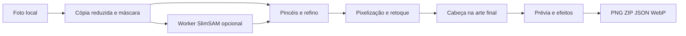

# Arquitetura do editor fotográfico local

Estado atual: [Studio publicado em d61fdfb](studio-published.md), conferido em 19/10/2026. O editor transforma uma foto local em recorte pixelizado animado. Não usa LLM, serviço de geração, Gradio, Prodia ou freellmapi. SlimSAM é um modelo de segmentação opcional executado localmente, não um gerador de personagens.

## Componentes e fluxo

Os arquivos estáticos publicados estão em [daneiel.github.io/virapets](https://github.com/daneiel/daneiel.github.io/tree/d61fdfbb0d89c2258b7f6989172ad04f164535a3/virapets). O repositório do plugin contém o pipeline Python e a documentação; não contém automaticamente todos os commits de desenvolvimento do site.

| Componente | Responsabilidade |
|---|---|
| `photo-editor.js` | Imagem em memória, pontos, máscara/histórico, ferramentas, retoques, cabeça e receita |
| `photo-mask.js` | Inversão, combinação e refino de máscaras sem alterar os arrays de entrada |
| `photo-core.js` | Quantização determinística, transformação contínua do recorte e efeitos ancorados |
| `photo-sam-client.js` / `photo-sam-worker.js` | Carregamento sob demanda, protocolo serializado, inferência e cancelamento |
| `mode-inline.js` | Composição dos painéis, ocultação/inert, única prévia no destino ativo |
| `app.js` / `stickers.js` | Prévia, simulação e exportações; captura estável de arte antes da montagem |
| `pet-core.js` | Catálogo procedural e contrato comum dos quatro humores, receita e ZIP |

## Imagem, seleção e arte

PNG/JPEG/WebP de até 10 MiB e 40 MP é decodificado e reduzido a até 768 px de lado maior. A máscara começa com pixels visíveis; há até 128 pontos e histórico de até dez alterações. Pontos positivos/negativos podem ser corrigidos por pincéis. Objeto inteiro prefere um candidato mais amplo com score aceitável e compatível com os pontos; detalhe prefere o maior score. Adicionar/remover combina a próxima seleção com a base. Pet/Fundo mostra a seleção ou seu complemento; expandir/contrair/suavizar trabalha com raio 1–4.

A pixelização recorta os limites da máscara, quantiza de 2–32 cores, usa grade 16–96, contorno opcional e margem transparente. Fundo colorido é aplicado em uma cópia. Os pixels originais não são pintados pelas ferramentas de máscara ou fundo. Aplicar novamente substitui os retoques da arte.

A cabeça é marcada na arte final 256×256; centro e raio são normalizados e transformados junto com a arte. Reaplicar o recorte limpa essa marca. Raios de latido e Zzz seguem a cabeça, ajustam o lado nas bordas e não são o guia circular de edição. A prévia interpola oito poses; Zzz não aparecem no despertar 4/5. O recorte não ganha expressões novas nem áudio.

## Composição inline e estado

`#procedural-editor` contém o destino procedural e suas instruções, ficando hidden/inert em foto. O mesmo nó `.studio` se move para `#photo-output`, dentro do editor fotográfico. Ele inteiro fica oculto/inert enquanto não há arte pronta. A importação JSON permanece acima dos painéis. Não há modal, clone de formulário ou listeners duplicados. Os nós e o estado de foto/máscara/cabeça/configuração são preservados na alternância.

Isso corrige a regressão anterior: ocultar apenas os campos procedurais deixava o card Pingo vazio e exportações abaixo da foto. O [relatório final](../validation/mode-regression-public.json) registra display computado, espaço ocupado, foco, ancestralidade e unicidade em desktop/mobile.

## Modelo, rede e cache

Runtime oficial `@huggingface/transformers` 3.8.1; ONNX Runtime WASM CPU em Worker módulo, single thread, sem exigir WebGPU. Modelo SlimSAM q8 `Xenova/slimsam-77-uniform`, revisão `5850ab45f587c112167512ffef949107115e26a0`.

| Download inicial não comprimido | Bytes |
|---|---:|
| Pesos e configuração | 13.786.820 |
| Runtime JS/WASM | 22.528.676 |
| Total de referência | **36.315.496** |

Arquivos pequenos da página não estão nessa soma; compressão/cache podem reduzir tráfego. O runtime vem do site; pesos/configuração vêm do Hugging Face/CDNs somente após ativação. Requisições de arquivos expõem IP e metadados normais aos hosts. Pixels seguem para o Worker local por `postMessage`, sem upload ou API de inferência. Embeddings são reutilizados para pontos da mesma imagem.

O cache específico `virapets-slimsam-<revision>` guarda arquivos do modelo, não fotos ou embeddings. Cancelar/liberar encerra o Worker; limpar cache remove os pesos armazenados. Se o cache ou download falhar, a pessoa pode continuar com pincéis. Não prometer primeira visita offline, consumo fixo de RAM ou desempenho universal. [Licenças e avisos distribuídos](https://daneiel.github.io/virapets/vendor/PHOTO-ML-NOTICES.txt).

## Exportação e compatibilidade

- PNG: RGBA 2048×256, oito células por humor; ZIP contém quatro faixas, manifesto, receita e instruções.
- PNGs fotográficos já incorporam os efeitos; `sleepSigns` contém oito `null` para evitar Zzz duplicado no pipeline.
- Figurinhas fotográficas: quatro WebPs 512×512, 32 quadros por humor, arredondamento acumulado de tempos; limite de tamanho validado. Procedural conserva oito quadros.
- JSON: PNG derivado 256×256, grade e cabeça normalizada, sem foto original, EXIF, nome da fonte ou máscara. A receita é validada; arquivo máximo de 450.000 bytes. Para recortar novamente, é necessário selecionar a foto original.
- Exportações assíncronas usam cópia estável de arte/cabeça para não misturar uma edição posterior entre quadros.

Canvas WebP pode usar compressão com perdas. O pipeline Python/Pillow gera GIFs, galeria e figurinhas localmente; não é requisito do visitante. Importação WhatsApp depende de aplicativo Android compatível e ainda não foi verificada em aparelho.

## Evidências e marcos

| Marco histórico | Evidência |
|---|---|
| Primeiro editor público `2ff19ad`, Pages 39249300236 | [Relatório original](../validation/photo-editor-public.json) |
| Movimento/cabeça/seleção `f18e579` | [Relatório de efeitos](../validation/cutout-public.json) |
| Espécies/inline/tema `a0926da` | [Relatório de espécies](../validation/species-inline-public.json) |
| Separação completa de modos `d61fdfb`, Pages 39257004280 | [Relatório final](../validation/mode-regression-public.json) |

40 testes Node passaram na última rodada de código: core, foto, máscaras, SAM, espécies e WebP. QA público Chromium, viewports 390/1440, cabeça nas bordas, receitas, modelo real em rodada anterior, exportações Pillow e ZIP→deliver→validate→build em clones isolados. Não há teste de aparelhos físicos, Firefox/Safari, importação real Android ou nova instalação pessoal de pet. Os relatórios mantêm o escopo e os commits reais de cada rodada.
